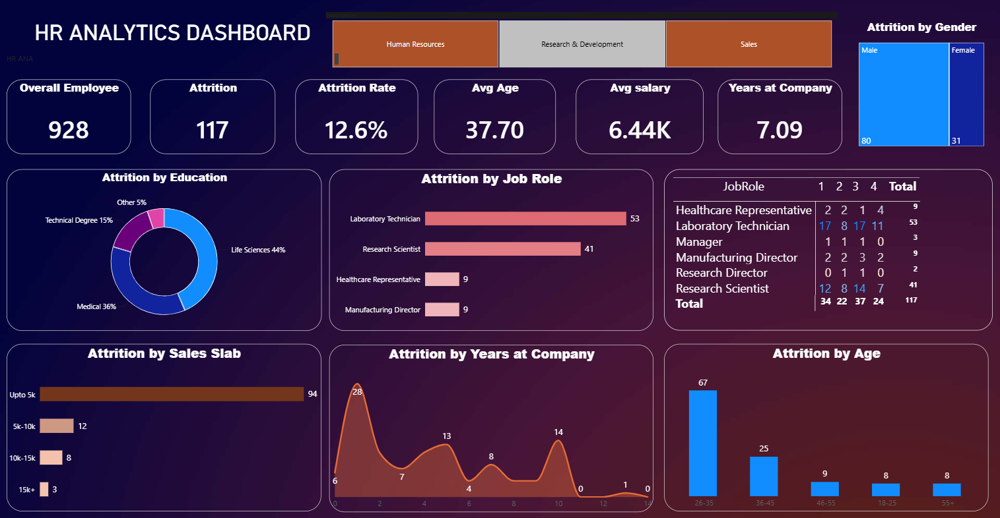

# HR Analytics Dashboard

A Power BI dashboard that analyzes employee attrition across education, job role, salary, tenure, age and gender to help understand why employees leave.



## Objective
Identify which employee groups have the highest attrition and what factors (salary, tenure, age, role) are linked to people leaving the company.

## Key Metrics
| Metric | Value |
|---|---|
| Overall Employees | 928 |
| Attrition (employees who left) | 117 |
| Attrition Rate | 12.6% |
| Average Age | 37.70 |
| Average Salary | 6.44K |
| Average Years at Company | 7.09 |

## Dashboard Features
- KPI cards: employees, attrition, attrition rate, average age, average salary, years at company
- Attrition by Gender, Education, Job Role, Sales Slab, Years at Company and Age
- Job role breakdown table by rating level (1 to 4)
- Department slicer: Human Resources, Research & Development, Sales

## Key Insights
- **Laboratory Technicians** have the highest attrition (53 of 117), followed by Research Scientists (41).
- Employees in the **lowest salary slab (up to 5k)** account for 94 of the 117 attrition cases.
- Attrition peaks early, at about **1 year at the company** (28 cases), with a smaller peak around year 10.
- The **26-35 age group** has the most attrition (67), and it drops sharply in older groups.
- Employees with a **Life Sciences (44%)** or **Medical (36%)** education background leave the most.
- Male employees show higher attrition than female employees (80 vs 31 in the selected view).

## Tools Used
- Power BI (dashboard and visuals)
- DAX (attrition rate and other measures)
- Excel / CSV (data source)

## Repository Structure
```
hr-analytics-dashboard/
├── README.md
├── .gitignore
├── hr_dashboard.png
├── HR_Analytics_Dashboard.pbix
└── hr_data.xlsx
```

## How to Use
1. Clone this repository.
2. Open `HR_Analytics_Dashboard.pbix` in Power BI Desktop.
3. If prompted, point the data source to `hr_data.xlsx`.
4. Use the department slicer at the top to filter the dashboard.

## Author
**Alen**: Data Science & Analytics graduate, Thrissur, Kerala
